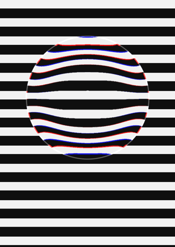

# After Effects Scripts

| スクリプト | 内容 |
|---|---|
| [`GlassLens.jsx`](#glasslens--シェイプ1枚をガラスレンズにする) | シェイプ1枚を、背景を屈折させるガラスレンズにする |
| [`DotMagnet.jsx`](#dotmagnet--after-effects-インタラクティブドットフィールド) | ヌルに反応するインタラクティブなドットフィールド |

---

# GlassLens — シェイプ1枚をガラスレンズにする



選択したシェイプレイヤーを、下にある映像を**屈折させるガラス**に変えます。
縁ほど強く屈折して背景が縁に沿って圧縮され、色収差と細いリムが付きます。
いわゆる「2D SDF Shape」のガラス表現を、AE標準エフェクトだけで再現しています。

※ 上のプレビューは、スクリプトと同じ処理を Python で再現したシミュレーションです。

- **シェイプ1枚で完結**: 操作するのは元のシェイプだけ。調整はそのシェイプの `GL ～` スライダーで行う
- **モーション・モーフィングで崩れない**: 補助レイヤーは元シェイプの全プロパティ
  (パス、楕円/長方形のサイズ・角丸、グループのトランスフォーム、レイヤーの移動・回転・スケール・親子付け)
  にエクスプレッションでリンク済み。パスのキーフレームでモーフィングしても追従する
- 円、角丸長方形、星、X、テキストから作ったシェイプなど、**どんな形でも**同じように効く

## 使い方

1. `ファイル > スクリプト > スクリプトファイルを実行...` で `GlassLens.jsx` を実行
   (または `Scripts/ScriptUI Panels` フォルダに入れて AE を再起動し、`ウィンドウ` メニューから開く)
2. 背景の上にシェイプレイヤーを作り、選択する
3. パネルの **適用** を押す
4. そのシェイプを動かす・パスを変形する・スライダーを調整する

### パネル

| UI | 動作 |
|---|---|
| **適用 (Apply)** | 選択シェイプにレンズを適用(適用済みなら作り直す)。複数選択で一括適用 |
| **再構築 (Rebuild)** | シェイプ内のグループを追加/削除したあと、名前を変えたあとに押す。スライダーの値は保持 |
| **解除 (Remove)** | レンズを外して元のシェイプに戻す(補助レイヤー・プリコンプ・平面もすべて片付ける) |
| **プリセット + 適用** | 標準 / 球体 / ガラス板 / 水滴 / すりガラス / 凹レンズ の値をスライダーに一括設定(キーフレームのある値は上書きしない) |
| **適用時に 16bpc に上げる** | オンなら適用時にプロジェクトを 16bpc に上げる(8bpc だと屈折に段差が出るため)。下げることはしない |
| **補助レイヤー表示/非表示** | シャイ表示の切り替え |

再構築・解除・プリセットは、元シェイプでも補助レイヤーでも、どちらを選んでいても動きます。

## コントロール(シェイプのエフェクトコントロール)

すべて **0〜100 のドラッグ範囲内**で調整できるようにしています。

| コントロール | 初期値 | 効果 |
|---|---|---|
| **GL Refraction** | 50 | 屈折の強さ。50 で「エッジ幅と同じ距離」だけ背景がずれる |
| **GL Edge Width %** | 50 | 縁から内側へ、屈折が起きる幅。**シェイプの大きさ(短辺の半分)に対する%** なので、拡大縮小・モーフィングしても質感が変わらない。100 で球体っぽく、20 前後で板ガラス風 |
| **GL Magnify +%** | 5 | 内側の拡大 |
| **GL Dispersion** | 5 | 色収差(屈折に対する%)。0 で無効 |
| **GL Frost Blur** | 0 | すりガラス風のぼかし(px) |
| **GL Rim Opacity** | 50 | 縁ハイライトの不透明度(%) |
| **GL Rim Width** | 2 | 縁ハイライトの幅(px) |
| **GL Invert (Concave)** | オフ | オンで屈折の向きを反転(凹レンズ) |

シェイプ自体の **不透明度** を下げると、レンズ全体がフェードします。

## 仕組み

```
シェイプ ──リンク複製──▶ GL_H_<名前>   白で塗る → Fast Box Blur
                                        = 縁で0、内側で1になる高さマップ(SDF的)
            GL_MAP_<名前> 高さマップを ±e ずらして加算/減算
                          = 勾配(法線)を R=横 / G=縦 に格納した変位マップ
メインコンプ  GL Map      変位マップ(非表示)。エッジ幅・屈折量 px を毎フレーム自動計算
              GL Lens     調整レイヤー: ぼかし → 拡大 → Displacement Map(シェイプのアルファでマット)
              GL Disp R/B 赤・青だけ追加でずらして Lighten = 色収差
              GL Rim      シェイプ − 内側に縮めたシェイプ = 縁ハイライト
```

補助レイヤーはすべて **シャイ+ロック** されます(パネルの「補助レイヤー表示/非表示」で表示)。
元のシェイプはトラックマットとして使うため非表示になります。

## 注意

- **After Effects 2023 以降を推奨**(トラックマットのレイヤー指定APIを使用)。
  それより古いバージョンでは、マット用の複製レイヤーを自動で挟んで動作します。
- 屈折の向きが思っていたのと逆に見える場合は、`GL Invert (Concave)` をオンにしてください。
- シェイプやコンプの**名前を変えた**ら **再構築** を押してください(エクスプレッションが名前で参照しているため)。
- コンプの長さを伸ばしたときも **再構築** を押してください(プリコンプの長さを合わせるため)。
- 色管理で「リニアワークスペース」を使うと、変位マップの中立値(50%グレー)がずれてレンズ全体が少しずれることがあります。

## 検証

AE を使わずにロジックを検証するテストを同梱しています(Node.js が必要)。

```
node tests/GlassLens.test.js GlassLens.jsx
```

AE の挙動(エフェクト追加後の参照無効化、ロック、エクスプレッションの評価、トラックマット、
レイヤー型パラメータの追従)を再現したモック上で、パネルの全ボタン・ドロップダウン・チェックボックスを操作し、
生成される全エクスプレッションを実際に評価して、座標変換やコントロールの効き方を数値で確認します
(親子付け、負のスケール、ロック、位置の次元分割、名前の記号、旧AE など 13 ケース)。

---

# DotMagnet — After Effects インタラクティブ・ドットフィールド

円状（極座標グリッド）に並んだドット群が、1つの可動ヌル `DOT_FIELD` に
近づくと**サイズと色が変化**する、インタラクティブなフィールドを
After Effects に一発生成する ExtendScript です。

- `DOT_FIELD` ヌルを動かす → 近くのドットだけ大きくなり、色がつく
- `DOT_FIELD` のスライダー → 影響範囲・サイズ・色の強さ・ランダム量を自在に調整
- ヌルの位置にキーフレームを打てば、波が走るようなアニメーションになる

## 使い方

1. After Effects を起動
2. `File > Scripts > Run Script File...` から `DotMagnet.jsx` を選択
   （または ScriptUI Panels フォルダに入れて `Window` メニューから開く）
3. `DotMagnet` コンプが生成される
4. `DOT_FIELD` ヌルを選んでドラッグ／キーフレーム → 近くのドットが反応

## コントロール（`DOT_FIELD` 上のスライダー）

| スライダー | 効果 |
|---|---|
| **Radius** | 影響範囲(px)。これ以内のドットが反応 |
| **Max Scale** | ヌル中心での最大サイズ(%) |
| **Base Scale** | 範囲外（遠い）ドットのサイズ(%) |
| **Falloff** | 反応の鋭さ（大きいほど中心付近だけ反応）|
| **Color Amount** | 近づいたとき色がつく強さ(%) |
| **Variation** | ドットごとのサイズのランダムばらつき(%) |
| **Seed** | 乱数の種。スクラブするとランダムパターンが変わる |

## 注意

- `DOT_FIELD` には**親（ペアレント）を付けない**でください
  （コンプ座標で距離を測っているため）。
- 全ドットが同じエクスプレッションを共有する軽量設計です。
- 同名コンプが既にある場合は確認ダイアログを出してから作り直すため、
  ボタンを何度押しても重複生成されません。

## カスタマイズ

`DotMagnet.jsx` 冒頭の `CONFIG` を書き換えるだけで、ドット数・リング数・間隔・
ドットサイズ・色パレット・各スライダー初期値・コンプ設定を変更できます。
